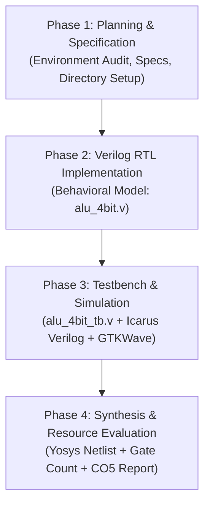

# Simple ALU Using Verilog HDL

**Course:** B.Tech CSE — Semester 3  
**Subject:** Digital Electronics / Digital Logic Design  
**Course Outcome (CO5):**  
> *"Create simulation models of digital circuits using HDL and software tool that verify functionality and evaluate performance."*

---

## 1. Project Overview

An **Arithmetic Logic Unit (ALU)** is the computational core of any central processing unit (CPU). It executes fundamental arithmetic calculations (such as addition and subtraction) and bitwise logical operations (such as AND, OR, XOR, and NOT).

This project designs, simulates, and synthesizes a **4-bit Simple ALU** using **Verilog Hardware Description Language (HDL)**. Through this project, we demonstrate the complete digital design flow: from mathematical specification and Register-Transfer Level (RTL) behavioral modeling to functional simulation with waveform analysis and gate-level synthesis.

---

## 2. Key Features

- **4-bit Word Size:** Operates on two 4-bit operands ($A$ and $B$).
- **3-bit Opcode Control:** Supports $2^3 = 8$ operation codes (6 core operations + 2 reserved safe default states).
- **Arithmetic Operations:**
  - Addition (`A + B`) with Carry-out detection.
  - Subtraction (`A - B`) with Borrow detection.
- **Logic Operations:**
  - Bitwise AND (`A & B`).
  - Bitwise OR (`A | B`).
  - Bitwise XOR (`A ^ B`).
  - Bitwise NOT of operand A (`~A`).
- **Comprehensive Flag Generation:**
  - **Carry Flag:** Flags unsigned overflow during addition.
  - **Borrow Flag:** Flags underflow during subtraction ($A < B$).
  - **Zero Flag:** Active-high flag asserted whenever `result == 4'b0000`.
- **Deterministic Default State:** Unused opcodes (`110` and `111`) output zero with flags predictably set, preventing indeterminate hardware states (latches).

---

## 3. Inputs, Outputs & Opcode Summary

### Interface Summary

| Port Name | Direction | Bit Width | Type | Description |
| :--- | :---: | :---: | :---: | :--- |
| `A` | Input | 4-bit `[3:0]` | `wire` | First data operand |
| `B` | Input | 4-bit `[3:0]` | `wire` | Second data operand |
| `opcode` | Input | 3-bit `[2:0]` | `wire` | Operation selector code |
| `result` | Output | 4-bit `[3:0]` | `reg` / `wire` | Computation output |
| `carry` | Output | 1-bit | `reg` / `wire` | Carry-out flag (valid for addition) |
| `borrow` | Output | 1-bit | `reg` / `wire` | Borrow flag (valid for subtraction) |
| `zero` | Output | 1-bit | `wire` | Zero flag (`1` when `result == 0`) |

### Opcode Mapping

| Opcode (`[2:0]`) | Operation | Expression | Carry Flag | Borrow Flag | Zero Flag |
| :---: | :--- | :--- | :---: | :---: | :---: |
| `000` | Addition | `A + B` | `1` if sum > 15, else `0` | `0` | `1` if result = 0, else `0` |
| `001` | Subtraction | `A - B` | `0` | `1` if A < B, else `0` | `1` if result = 0, else `0` |
| `010` | Bitwise AND | `A & B` | `0` | `0` | `1` if result = 0, else `0` |
| `011` | Bitwise OR | `A \| B` | `0` | `0` | `1` if result = 0, else `0` |
| `100` | Bitwise XOR | `A ^ B` | `0` | `0` | `1` if result = 0, else `0` |
| `101` | Bitwise NOT | `~A` | `0` | `0` | `1` if result = 0, else `0` |
| `110` | Reserved | `4'b0000` | `0` | `0` | `1` (Safe zero output) |
| `111` | Reserved | `4'b0000` | `0` | `0` | `1` (Safe zero output) |

---

## 4. Development Environment & Toolchain Status

### Host Environment
- **Operating System:** Microsoft Windows 11 Home Single Language (64-bit, Version 10.0.26200)
- **Host Terminal:** Windows PowerShell 5.1 / PowerShell 7
- **Package Managers Found:** `winget`, `choco` (Chocolatey), `scoop`

### Tool Verification Audit

To ensure academic and engineering rigor, all required tools have been audited on the system:

| Tool | Purpose in Project | Target Phase | Status on System | Action Required |
| :--- | :--- | :---: | :---: | :--- |
| **Git** | Version control & repository tracking | All | ✅ **Installed** (`C:\Program Files\Git\cmd\git.exe`) | None |
| **Python 3** | Automation scripts & result checking | Phase 3/4 | ✅ **Installed** (`Python 3.10.x`) | None |
| **Icarus Verilog (`iverilog` & `vvp`)** | Verilog HDL compiler & simulation runtime | Phase 2 & 3 | ✅ **Installed & Verified** (`v14.0 devel`) | None (Installed via Scoop) |
| **GTKWave (`gtkwave`)** | Graphical waveform viewer for `.vcd` files | Phase 3 | ✅ **Installed & Verified** (`v3.3.128`) | None (Installed via Scoop) |
| **Yosys (`yosys`)** | Open-source RTL synthesis suite & gate mapping | Phase 4 | ✅ **Installed & Verified** (`v0.9`) | None (Installed via Scoop) |
| **Graphviz (`dot`)** | Schematic graph rendering (DOT -> SVG/PNG) | Phase 4 | ✅ **Installed & Verified** (`v16.1.0`) | None (Installed via Scoop) |

*(Refer to [`docs/tool_setup_guide.md`](docs/tool_setup_guide.md) for tool installation instructions).*

---

## 5. Roles of Tools Across Project Phases

1. **Verilog HDL (IEEE 1364-2001 / 2005):**
   - The hardware description language used to write the synthesizable behavioral model of the 4-bit ALU (`src/alu_4bit.v`) and the stimulus testbench (`tb/alu_4bit_tb.v`).
2. **Icarus Verilog (`iverilog` & `vvp`):**
   - **`iverilog`:** Compiles Verilog RTL and testbench source files into an intermediate simulation binary.
   - **`vvp`:** Runs the simulation binary, evaluates all 24 self-checking test vectors, and dumps a Value Change Dump (`sim/alu_wave.vcd`) waveform.
3. **GTKWave:**
   - Visual waveform analyzer used to inspect digital timing transitions ($0 \to 1$, $1 \to 0$), opcodes, arithmetic carries, borrows, and zero flag behavior across the $0\text{ns}$ to $250\text{ns}$ simulation window.
4. **Yosys Open SYnthesis Suite:**
   - Synthesizes behavioral Verilog into a structural gate-level netlist (`syn/alu_synth.v`) mapped to standard logic gates, producing detailed gate counts and cell statistics.
5. **Graphviz (`dot`):**
   - Renders the synthesized circuit graph into graphical schematic files (`syn/alu_schematic.svg` and `syn/alu_schematic.png`).

---

## 6. Four-Phase Development Plan



- **Phase 1: Planning and Project Initialization (Completed)**
  - Audit development environment.
  - Establish directory structure.
  - Author formal design specifications, truth tables, and block diagrams.
  - Define exact behavior for operations, flags, and unused opcodes.
- **Phase 2: Verilog RTL Implementation (Completed)**
  - Implement `src/alu_4bit.v` using clean, synthesizable behavioral Verilog.
  - Implement multiplexer logic using `case (opcode)`.
  - Implement full 5-bit arithmetic to cleanly capture carry and borrow.
  - Compute continuous zero flag using reduction logic.
- **Phase 3: Testbench Development, Simulation & Waveform Verification (Completed)**
  - Implement exhaustive self-checking testbench `tb/alu_4bit_tb.v`.
  - Simulate using `iverilog` and `vvp` (24/24 Tests PASSED).
  - Dump simulation waveforms to `sim/alu_wave.vcd`.
  - Provide GTKWave visual waveform inspection guide.
- **Phase 4: Synthesis, Performance Evaluation & Final Documentation (Completed)**
  - Synthesize design with Yosys (`syn/synth.ys` -> `syn/alu_synth.v`).
  - Generate gate count statistics (133 basic gates: 51 AND, 50 OR, 24 NOT, 8 XOR).
  - Render gate-level schematic (`syn/alu_schematic.svg` and `.png`).
  - Author 14-section final academic report (`docs/PROJECT_REPORT.md`).
  - Author 20-question viva voce preparation guide (`docs/VIVA_QUESTIONS.md`).
  - Create final deliverables verification checklist (`docs/FINAL_DELIVERABLES.md`).

---

## 7. Deliverables Checklist

- [x] **Phase 1: Project Plan & Specification**
  - [x] Development environment audit documented.
  - [x] Clean directory layout created (`docs/`, `src/`, `tb/`, `sim/`, `syn/`).
  - [x] Comprehensive `README.md` with CO5 alignment.
  - [x] Design specification document (`docs/design_specification.md`) with architecture, block diagram, and flag definitions.
  - [x] Tool setup guide (`docs/tool_setup_guide.md`).
- [x] **Phase 2: Verilog RTL Implementation**
  - [x] Synthesizable Verilog module: `src/alu_4bit.v`.
  - [x] Port width, latch prevention, and static design verification completed.
  - [x] Toolchain verified: Icarus Verilog, GTKWave, Yosys, and Graphviz installed.
- [x] **Phase 3: Simulation and Verification**
  - [x] Verilog testbench: `tb/alu_4bit_tb.v` with 24 exhaustive self-checking test cases.
  - [x] Simulation waveform database: `sim/alu_wave.vcd` (8.6 KB verified).
  - [x] Automated verification log: 24/24 PASS (0 failures).
  - [x] Reproducible execution scripts: `run_sim.ps1` and `run_sim.bat`.
  - [x] GTKWave inspection guide and timing analysis instructions.
- [x] **Phase 4: Synthesis and Performance Evaluation**
  - [x] Yosys synthesis script: `syn/synth.ys`.
  - [x] Synthesized gate-level netlist: `syn/alu_synth.v`.
  - [x] Gate statistics extracted: `syn/synth_stat.txt` (133 logic gates).
  - [x] Structural gate schematics rendered: `syn/alu_schematic.svg` & `syn/alu_schematic.png`.
  - [x] Final academic project report: `docs/PROJECT_REPORT.md` (14 required sections).
  - [x] Viva voce examination preparation guide: `docs/VIVA_QUESTIONS.md` (20 questions).
  - [x] Master deliverables checklist: `docs/FINAL_DELIVERABLES.md`.
  - [x] Automation synthesis scripts: `run_synth.ps1` and `run_synth.bat`.

---

## 8. Directory Layout

```text
Simple_ALU_Verilog/
├── README.md                          # Master project documentation and roadmap
├── run_sim.ps1                        # PowerShell simulation runner script
├── run_sim.bat                        # Windows CMD batch runner script
├── run_synth.ps1                      # PowerShell synthesis & schematic runner script
├── run_synth.bat                      # Windows CMD synthesis batch script
├── .gitignore                         # Ignore temporary simulation/synthesis outputs
├── docs/
│   ├── design_specification.md        # Detailed hardware specs, truth table & diagrams
│   ├── tool_setup_guide.md            # Windows installation guide for Icarus, GTKWave, Yosys
│   ├── PROJECT_REPORT.md              # 14-section formal academic project report (CO5)
│   ├── VIVA_QUESTIONS.md              # 20 viva voce exam questions with answers
│   └── FINAL_DELIVERABLES.md          # Master verification and deliverables matrix
├── src/
│   └── alu_4bit.v                     # Synthesizable 4-bit ALU Verilog RTL module
├── tb/
│   └── alu_4bit_tb.v                  # 24-test self-checking simulation testbench
├── sim/
│   ├── alu_sim.vvp                    # Compiled Icarus Verilog simulation binary
│   └── alu_wave.vcd                   # Value Change Dump waveform for GTKWave
└── syn/
    ├── synth.ys                       # Yosys synthesis script
    ├── synth.log                      # Full synthesis log file
    ├── synth_stat.txt                 # Extracted gate cell statistics
    ├── alu_synth.v                    # Synthesized gate-level Verilog netlist
    ├── alu_schematic.dot              # Graphviz DOT circuit graph
    ├── alu_schematic.svg              # Scalable vector graphics schematic
    └── alu_schematic.png              # High-resolution PNG gate schematic
```

---

## 9. Quick Start: How to Run on Windows

Open PowerShell in the `Simple_ALU_Verilog` directory:

```powershell
# 1. Run Functional Simulation (Compiles, executes 24 tests, dumps waveform)
powershell -ExecutionPolicy Bypass -File .\run_sim.ps1

# 2. View Waveforms in GTKWave
gtkwave sim/alu_wave.vcd

# 3. Run Logic Synthesis with Yosys (Synthesizes netlist & generates schematic)
powershell -ExecutionPolicy Bypass -File .\run_synth.ps1
```

*(For Windows Command Prompt CMD users, simply run `run_sim.bat` and `run_synth.bat`).*

