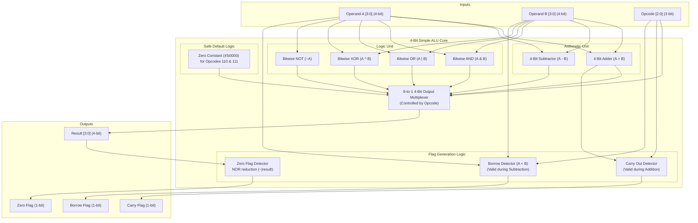

# 4-Bit Simple ALU — Hardware Design Specification

**Document Version:** 1.0  
**Project:** Simple ALU Using Verilog HDL  
**Target Course:** B.Tech CSE Semester 3 — Digital Electronics  
**Course Outcome (CO5):** Create simulation models of digital circuits using HDL and software tool that verify functionality and evaluate performance.

---

## 1. Introduction & Beginner Concepts

As a student learning Digital Electronics and Computer Architecture, understanding the **Arithmetic Logic Unit (ALU)** is essential. The ALU is the computational engine inside microprocessors (like the Intel x86, ARM, or RISC-V processors) that performs mathematical calculations and decision-making operations.

### Key Technical Terms Explained Simply

1. **Hardware Description Language (HDL):**
   Unlike programming languages like C, Java, or Python which describe a sequence of instructions executed step-by-step on a CPU, an HDL (such as Verilog or VHDL) describes the **physical arrangement and interconnection of hardware components** (wires, logic gates, flip-flops, multiplexers) that operate in parallel.

2. **Verilog HDL:**
   An industry-standard IEEE language (IEEE 1364) designed to model digital systems. It allows hardware designers to express circuit behavior at the Register-Transfer Level (RTL) or gate level.

3. **Register-Transfer Level (RTL):**
   An abstraction level in digital design where the flow of digital signals between hardware registers and the logical operations performed upon those signals are described using clear boolean or behavioral expressions.

4. **ALU Status Flags:**
   1-bit indicators (flip-flops in a CPU's Processor Status Word or Flags Register) that record special attributes about the outcome of the most recent operation. For example:
   - Did the addition exceed the 4-bit capacity? $\to$ **Carry Flag**.
   - Did the subtraction require a borrow because $A < B$? $\to$ **Borrow Flag**.
   - Did the calculation yield zero? $\to$ **Zero Flag** (used by `JZ` - Jump if Zero instructions in assembly language).

5. **Simulation vs. Synthesis:**
   - **Simulation (Phase 3):** Running the Verilog model inside a software engine (like Icarus Verilog) to verify that the logic works correctly before touching any physical hardware.
   - **Synthesis (Phase 4):** Translating the abstract Verilog description into an actual network of logic gates (AND, OR, NOT, multiplexers) using synthesis software (like Yosys).

---

## 2. ALU Architecture & Block Diagram

The 4-bit ALU accepts two 4-bit data operands ($A$ and $B$) and a 3-bit control opcode ($opcode$). Internally, the circuit consists of:
- **Arithmetic Unit:** Computes 4-bit addition ($A + B$) with a 5th carry-out bit, and 4-bit subtraction ($A - B$) with borrow detection.
- **Logic Unit:** Computes bitwise AND, bitwise OR, bitwise XOR, and bitwise NOT of operand $A$.
- **Multiplexer / Selector:** An 8-to-1 4-bit multiplexer controlled by `opcode[2:0]` that routes the requested computation to the `result[3:0]` output bus.
- **Flag Generation Unit:** Combinational logic that continuously evaluates and drives the `carry`, `borrow`, and `zero` flags.

### Architecture Block Diagram



---

## 3. Port & Signal Definitions

### Input Ports

| Signal Name | Width | Type | Description |
| :--- | :---: | :---: | :--- |
| `A[3:0]` | 4-bit | `wire` | First data operand. Represents unsigned numbers in the range $[0, 15]$ ($4'b0000$ to $4'b1111$). |
| `B[3:0]` | 4-bit | `wire` | Second data operand. Represents unsigned numbers in the range $[0, 15]$ ($4'b0000$ to $4'b1111$). |
| `opcode[2:0]` | 3-bit | `wire` | Operation select input. Decodes into one of 8 operations ($2^3 = 8$). |

### Output Ports

| Signal Name | Width | Type | Description |
| :--- | :---: | :---: | :--- |
| `result[3:0]` | 4-bit | `reg` / `wire` | Primary computation result driven by the selected opcode. |
| `carry` | 1-bit | `reg` / `wire` | Asserted (`1'b1`) when an addition generates a carry out of the most significant bit (MSB, bit 3). Always `1'b0` for all non-addition operations. |
| `borrow` | 1-bit | `reg` / `wire` | Asserted (`1'b1`) during subtraction when operand $A$ is strictly less than operand $B$ ($A < B$), indicating an unsigned underflow. Always `1'b0` for all other operations. |
| `zero` | 1-bit | `wire` | Asserted (`1'b1`) whenever the output `result` is exactly zero (`4'b0000`). Cleared (`1'b0`) otherwise. |

---

## 4. Operation Specifications & Opcode Mapping

The 3-bit opcode selects among 6 active operations and 2 reserved safe default states.

### Opcode Mapping & Truth Table

| Opcode `opcode[2:0]` | Operation Category | Operation Name | Mathematical / Logical Expression | `result[3:0]` Output | `carry` Flag | `borrow` Flag | `zero` Flag |
| :---: | :---: | :---: | :---: | :---: | :---: | :---: | :---: |
| `3'b000` | Arithmetic | **Addition** | $A + B$ | Lower 4 bits: $(A + B)[3:0]$ | `1` if $(A+B) > 15$, else `0` | `0` | `1` if `result == 0`, else `0` |
| `3'b001` | Arithmetic | **Subtraction** | $A - B$ | Lower 4 bits: $(A - B)[3:0]$ | `0` | `1` if $A < B$, else `0` | `1` if `result == 0`, else `0` |
| `3'b010` | Logical | **Bitwise AND** | $A \ \& \ B$ | $A[i] \ \& \ B[i]$ for $i \in [0,3]$ | `0` | `0` | `1` if `result == 0`, else `0` |
| `3'b011` | Logical | **Bitwise OR** | $A \ \| \ B$ | $A[i] \ \| \ B[i]$ for $i \in [0,3]$ | `0` | `0` | `1` if `result == 0`, else `0` |
| `3'b100` | Logical | **Bitwise XOR** | $A \ \text{\textasciicircum} \ B$ | $A[i] \ \text{\textasciicircum} \ B[i]$ for $i \in [0,3]$ | `0` | `0` | `1` if `result == 0`, else `0` |
| `3'b101` | Logical | **Bitwise NOT (A)** | $\sim A$ | $\sim A[i]$ for $i \in [0,3]$ | `0` | `0` | `1` if `result == 0`, else `0` |
| `3'b110` | Reserved | **Unused Opcode 1** | Default State | `4'b0000` | `0` | `0` | `1` |
| `3'b111` | Reserved | **Unused Opcode 2** | Default State | `4'b0000` | `0` | `0` | `1` |

---

## 5. Detailed Flag Behavior & Mathematical Rationale

Digital signal flags communicate the condition of the computation to external processor registers. Here is the formal behavior for each flag:

### 1. Carry Flag (`carry`)
- **Active Context:** Valid exclusively for the **Addition** operation (`opcode == 3'b000`).
- **Mathematical Definition:**
  When adding two 4-bit unsigned integers:
  $$\text{Sum} = A + B$$
  The maximum possible sum is $15 + 15 = 30$. In binary, $30_{10} = 11110_2$ (a 5-bit quantity).
  - The lower 4 bits $[3:0]$ are assigned to `result`.
  - The 5th bit (bit 4) is assigned to `carry`.
- **Logic:**
  ```text
  If opcode == 3'b000 and (A + B > 15):
      carry = 1'b1
  Else:
      carry = 1'b0
  ```
- **Example:**
  - $A = 12\ (1100_2)$, $B = 5\ (0101_2) \implies \text{Sum} = 17\ (10001_2)$.
  - `result = 4'b0001`, `carry = 1'b1`.

### 2. Borrow Flag (`borrow`)
- **Active Context:** Valid exclusively for the **Subtraction** operation (`opcode == 3'b001`).
- **Mathematical Definition:**
  In unsigned 4-bit subtraction $A - B$:
  - If $A \ge B$, the difference is positive or zero and fits within 4 bits without requiring a borrow from a higher stage ($borrow = 0$).
  - If $A < B$, an underflow occurs. In modular 4-bit arithmetic ($2^4 = 16$), the output wraps around as $(16 + A - B)$, and a borrow is generated ($borrow = 1$).
- **Logic:**
  ```text
  If opcode == 3'b001 and (A < B):
      borrow = 1'b1
  Else:
      borrow = 1'b0
  ```
- **Example:**
  - $A = 4\ (0100_2)$, $B = 9\ (1001_2)$.
  - $4 < 9 \implies \text{Borrow needed}$.
  - `borrow = 1'b1`, `result = (16 + 4 - 9) = 11` (`4'b1011`).

### 3. Zero Flag (`zero`)
- **Active Context:** Continuously evaluated across **all operations**.
- **Mathematical Definition:**
  Asserted active-high (`1'b1`) if and only if every single bit of `result[3:0]` is logic `0`.
- **Hardware Realization:**
  In hardware, this is realized using a 4-input NOR gate or unary reduction NOR (`~(|result)`):
  $$\text{zero} = \overline{\text{result}[3] + \text{result}[2] + \text{result}[1] + \text{result}[0]}$$
- **Logic:**
  ```text
  zero = (result == 4'b0000) ? 1'b1 : 1'b0
  ```

---

## 6. Specification for Unused Opcodes (`3'b110` and `3'b111`)

In digital hardware design, leaving unmapped states undefined or floating leads to unpredictable hardware synthesis, potential latches, and power-consuming glitching.

To ensure deterministic, fail-safe behavior:
1. **Result Output:**
   - Both `3'b110` and `3'b111` strictly force `result = 4'b0000`.
2. **Arithmetic Flags:**
   - Since no addition or subtraction took place, `carry = 1'b0` and `borrow = 1'b0`.
3. **Zero Flag:**
   - Because `result` is explicitly driven to `4'b0000`, the zero detection logic detects that all result bits are zero and evaluates to `zero = 1'b1`.
   - This maintains 100% mathematical consistency with the definition of the zero flag.

---

## 7. Verilog Module Interface Definition (Phase 2 Preview)

To ensure seamless implementation in Phase 2, the module interface, port directions, and data types are defined as follows:

```verilog
// ============================================================================
// Module Name:  alu_4bit
// Project:      Simple 4-Bit ALU Using Verilog HDL
// Description:  Behavioral model of 4-bit ALU with arithmetic, bitwise logic,
//               and flag generation (Carry, Borrow, Zero).
// ============================================================================
module alu_4bit (
    input  wire [3:0] A,        // 4-bit input operand A
    input  wire [3:0] B,        // 4-bit input operand B
    input  wire [2:0] opcode,   // 3-bit operation select code
    output reg  [3:0] result,   // 4-bit computation result
    output reg        carry,    // Carry flag for addition
    output reg        borrow,   // Borrow flag for subtraction
    output wire       zero      // Zero flag (asserted when result is 0)
);

    // Module implementation will be completed in Phase 2

endmodule
```

---

## 8. Summary of Engineering Design Decisions

1. **Combinational Architecture:**
   The simple ALU is purely combinational, meaning its outputs immediately respond to changes in the inputs without requiring a clock signal (`clk`) or reset signal (`rst_n`).
2. **Clear Separation of Concerns:**
   Arithmetic carries and borrows are isolated from logical operations to prevent false flag triggers during masking or bitwise operations.
3. **Synthesis Friendliness:**
   The design uses standard Verilog constructs (`always @(*)`, `case`, continuous `assign` for zero flag) that synthesize directly into standard cell libraries without inferring unintentional latches.
